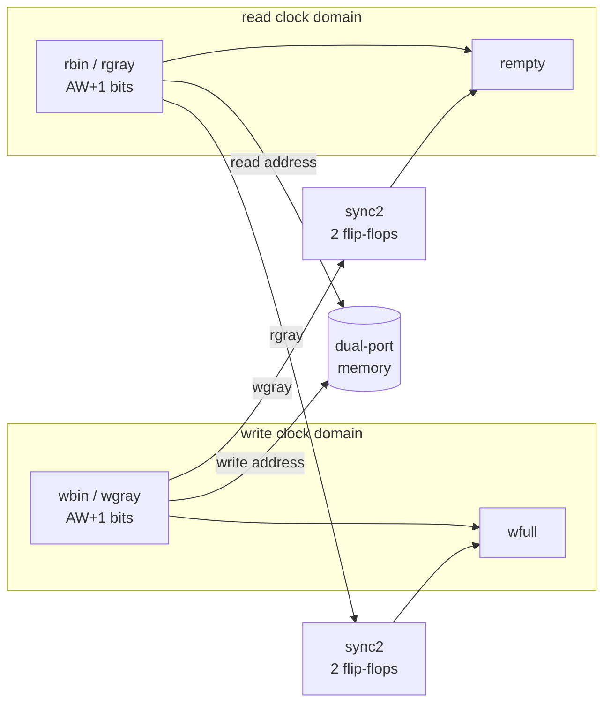

# Async FIFO: a CDC Bug That Simulation Cannot See

[](https://github.com/ymt1001816-cyber/async-fifo-cdc/actions/workflows/ci.yml)
[](https://github.com/ymt1001816-cyber/async-fifo-cdc/actions/workflows/openroad.yml)

An asynchronous FIFO (write and read in unrelated clock domains) in Verilog, verified with cocotb simulation **and** formal
verification with a metastability model. The point of the project: a classic clock-domain-crossing (CDC) bug
**passes every simulation** and is **caught by formal in 7 steps**.

Meiyu Kuo · personal project, 2026

## Result

| Version | cocotb simulation (3 seeds × 3 tests) | Formal (SymbiYosys, metastability model) |
|---|---|---|
| Gray-code pointers (`rtl/async_fifo.v`) | ✅ PASS | ✅ **PROVEN** (k-induction, unbounded): the properties hold in every reachable state, any clock ratio and phase |
| Pointers crossed in binary (`formal/async_fifo_binary_bug.v`) | ✅ **PASS (bug not seen)** | ❌ **FAIL in step 7**: `a_wptr_not_ahead` |

Why simulation misses it: in RTL simulation a flip-flop always captures a clean 0 or 1, so a multi-bit pointer is never
sampled mid-change. On silicon, when the source changes near the sampling edge, each bit can resolve to its old or its new
value independently. A binary pointer going `0111 → 1000` can be seen as `1111`, far ahead of the real pointer, and the
FIFO then reads data that was never written. A Gray pointer changes one bit per step, so it is always seen as either the old
or the new value.

## Design



- Cummings (SNUG 2002) style; parameters `DW` (data width) and `AW` (depth = 2^AW).
- Pointers are one bit wider than the address: equal pointers mean empty, pointers one lap apart mean full.
- Pointers cross clock domains in Gray code (`g = b ^ (b >> 1)`) through 2-flop synchronizers.
- **Full:** the next write Gray pointer equals the synchronized read Gray pointer with its top two bits inverted.
- **Empty:** the next read Gray pointer equals the synchronized write Gray pointer.
- Both flags are registered and pessimistic: a synchronized pointer lags, so full and empty may clear late but are never wrong.

## Verification

**Simulation** (`tb/test_fifo.py`, cocotb + Icarus Verilog)
- Two free-running clocks with a random phase: writer 2.6× faster, reader 2.6× faster, and random periods (3–20 ns, not multiples of each other).
- Scoreboard: every popped word must be the oldest pushed word (order and data).
- Safety: whenever the FIFO is really full, `wfull` must be 1; whenever it is really empty, `rempty` must be 1.
- Functional coverage: full and empty reached, requests while full or empty, every occupancy 0–16.

**Formal** (`formal/`, SymbiYosys + Yices)
- Clocks are free inputs (`multiclock on`): every frequency ratio and phase, including a stopped clock.
- Metastability model (`rtl/sync2.v`, `` `ifdef FORMAL ``): a bit that changed just before the sampling edge may be captured
  as its old or its new value, chosen by the solver, independently per bit.
- Properties (`formal/fifo_props.vh`):
  - `a_rptr_not_ahead`, `a_wptr_not_ahead`: a synchronized pointer may lag the real one but is never ahead of it (the CDC property).
  - `a_no_overflow`: never more than DEPTH words.
- **Unbounded proof** (`prove` task, k-induction, real depth 16, about 1 s): helper invariants (Gray pointer = binary pointer
  converted, the synchronizer chain only lags, each side's flag is set whenever its own view is full / empty) make the
  induction step go through. A mutated full flag makes the proof fail, so it is not vacuous; depths 4, 16 and 64 all prove.
- Cover statements prove the passing result is not vacuous: full (step 8), maximum occupancy (step 8) and both pointers wrapping (step 15) are reachable.

## Timing constraints for the crossings

`openroad/constraint.sdc` constrains the clock-domain crossings, and `.github/workflows/openroad.yml` takes the FIFO
through OpenROAD (nangate45) to a routed layout with a timing report of the crossing paths.

- Not a blanket `set_false_path` or `set_clock_groups -asynchronous` between the clocks: the Gray code only protects the
  pointer if all its bits arrive within one destination clock period of each other.
- `set_max_delay -ignore_clock_latency` bounds every crossing path (pointers and the memory read path) to one period of
  the faster clock; hold is not checked between the unrelated clocks (`set_false_path -hold`).

## Run it

Needs [OSS CAD Suite](https://github.com/YosysHQ/oss-cad-suite-build) (Verilator, Icarus Verilog, cocotb, Yosys, SymbiYosys).

```bash
ci/regress.sh all                       # lint, simulation, formal: 9 checks, about 15 s
cd tb && make                           # simulation only  (N=words per test, COCOTB_RANDOM_SEED=n)
cd tb && make BUG=binary                # the bug version in simulation: passes
cd formal && sby -f fifo.sby prove      # unbounded formal proof (also: bmc, cover, bug)
```

The same checks run in GitHub Actions on every push (`.github/workflows/ci.yml`). The `bug` check passes only if formal
**fails** on the bug version, so the regression proves the properties can catch a real CDC bug.

## Files

| Path | Contents |
|---|---|
| `rtl/async_fifo.v` | the FIFO |
| `rtl/sync2.v` | 2-flop synchronizer, with the formal metastability model |
| `tb/` | cocotb testbench and Makefile |
| `formal/fifo.sby`, `fifo_props.vh` | formal tasks (bmc, prove, cover, bug), properties and induction invariants |
| `formal/async_fifo_binary_bug.v` | planted bug: pointers synchronized in binary |
| `openroad/` | CDC timing constraints, OpenROAD config, crossing-path timing report |
| `ci/regress.sh` | regression script used by CI |

## Limitations

- The metastability model covers synchronizer sampling only; it does not model reset-deassertion CDC or glitches on combinational paths into a synchronizer.

## Related

[1 KB Cache: RTL to Signoff](https://github.com/ymt1001816-cyber/cache-rtl-to-signoff): a cache taken from RTL to a signed-off 45 nm layout, with UVM, cocotb, formal and DFT.

RTL written by Meiyu Kuo. Testbench, formal harness and documentation were developed with AI assistance (Claude).
